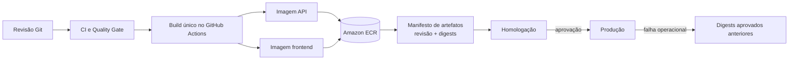
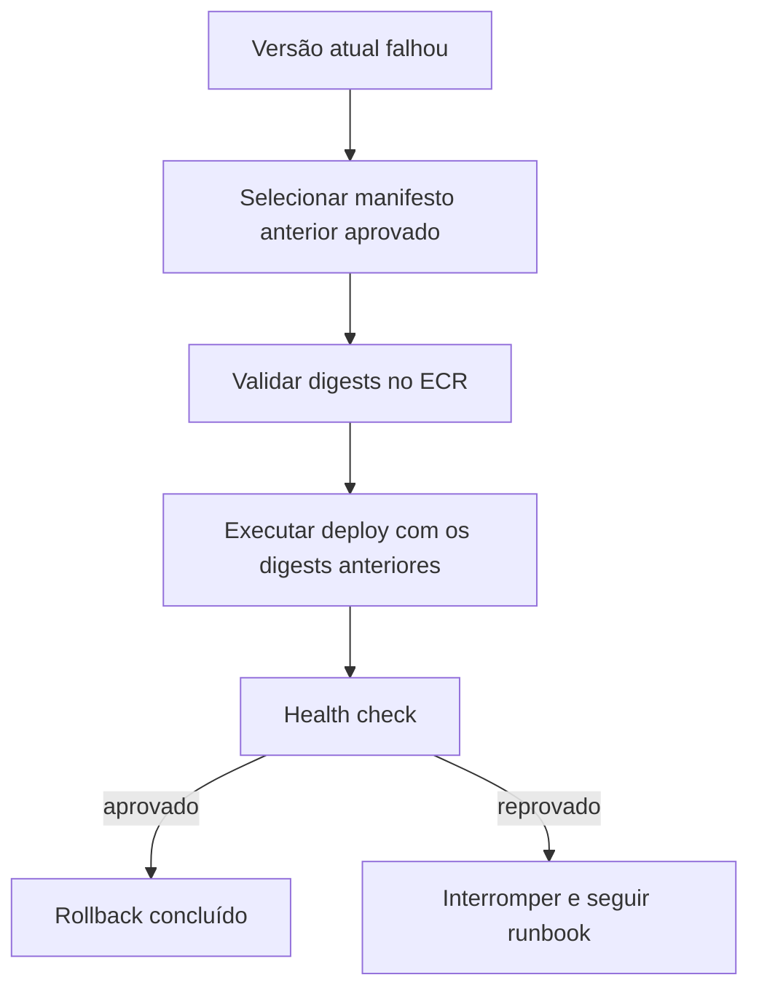

# ADR-0026 — Imagens imutáveis no ECR, promoção por digest e rollback

- Status: Aceito
- Data: 2026-10-11

## Contexto

O deploy efêmero atual seleciona uma revisão Git, clona o repositório na EC2 e executa
`docker compose up --build`. Isso é reproduzível o suficiente para a PoC, mas faz cada ambiente
recompilar a aplicação. Dois builds da mesma revisão podem divergir por mudança de imagem-base,
dependência externa ou ferramenta, e a revisão aceita em homologação não identifica por si só os
bytes executados em produção.

O ADR-0020 já definiu que promoção deve selecionar uma revisão validada e registrou como evolução a
produção única de artefatos imutáveis. Falta decidir onde esses artefatos serão armazenados, como
serão identificados, promovidos e usados para voltar a uma versão anterior.

## Decisão

Construir as imagens próprias da API e do front-end uma única vez no GitHub Actions e armazená-las no
Amazon Elastic Container Registry (ECR). O deploy não compilará código na EC2: receberá os digests das
imagens aprovadas e executará o Compose de produção com referências imutáveis.



### Repositórios e identidade

- manter repositórios ECR separados para `payflow-api` e `payflow-frontend`;
- tratar o ECR como fundação persistente de artefatos, independente do TTL dos ambientes de execução;
- habilitar criptografia, tags imutáveis, scan no push e política de ciclo de vida;
- conceder ao GitHub Actions, por OIDC, somente as permissões necessárias para publicar e consultar
  imagens;
- conceder à role da EC2 somente leitura dos repositórios;
- não armazenar secrets, arquivos `.env`, dados de usuário ou configuração específica de ambiente nas
  imagens.

Compartilhar os repositórios de artefatos entre `development`, `homologation` e `production` não
compartilha banco, Terraform state, parâmetro SSM ou secrets. Esses recursos continuam isolados pelo
ADR-0020.

### Build e identificação

O pipeline produzirá duas imagens para uma revisão:

```text
revisão Git
├── payflow-api@sha256:<digest-api>
└── payflow-frontend@sha256:<digest-frontend>
```

Tags legíveis, como o SHA do commit ou `vX.Y.Z`, poderão facilitar consulta, mas não serão a
identidade usada pelo deploy. Tags são referências auxiliares; o digest `sha256` identifica o
conteúdo exato.

O resultado do build será um manifesto ou saída equivalente contendo, no mínimo:

- SHA completo da revisão Git;
- digest da imagem da API;
- digest da imagem do front-end;
- data e execução do workflow que produziu os artefatos.

O pipeline deve reutilizar artefatos existentes para uma revisão já construída e não substituir tags
imutáveis. As imagens de terceiros, como PostgreSQL e Caddy, permanecem fora desse build; suas versões
continuam explicitamente fixadas e poderão ser presas por digest em uma mudança própria.

### Promoção entre ambientes

Promover significa fornecer ao ambiente seguinte o mesmo par de digests aprovado no ambiente
anterior:

```text
development   → revisão em integração e seus digests
homologation  → digests da candidata release/X.Y.Z
production    → exatamente os digests aprovados para a tag vX.Y.Z
```

O Compose de produção receberá referências como `API_IMAGE` e `FRONTEND_IMAGE` e usará `image:` em vez
de `build:`. O Compose local continuará podendo construir imagens a partir do código para preservar o
ciclo rápido de desenvolvimento.

Antes de publicar em produção, o workflow verificará que:

1. a tag anotada aponta para a revisão aprovada;
2. os dois digests pertencem a essa revisão;
3. as imagens existem no ECR e passaram pelas verificações obrigatórias;
4. nenhum build novo será executado durante a promoção.

### Rollback

O rollback da aplicação selecionará um manifesto aprovado anterior e reaplicará seus dois digests.
Não haverá rebuild, movimentação de tag nem alteração manual de container na EC2.



Rollback de imagem não reverte banco. Flyway permanece forward-only e migrations de uma release
devem ser compatíveis com a versão anterior durante a janela de rollback. Uma mudança de schema
incompatível exige estratégia expand/contract ou correção progressiva; restaurar backup é um processo
de recuperação de dados separado e não será automatizado como rollback comum.

O rollback de produção continuará sujeito à proteção e aprovação do GitHub Environment. A ação e os
digests escolhidos deverão permanecer auditáveis na execução do workflow.

## Implementação incremental

1. criar a fundação ECR, lifecycle policies e permissões OIDC mínimas;
2. criar workflow de build das duas imagens, scan e publicação com manifesto de digests;
3. adaptar o Compose e o deploy para consumir `API_IMAGE` e `FRONTEND_IMAGE` sem `--build`;
4. validar a mesma candidata em homologação e produção sem reconstrução;
5. criar o caminho manual e protegido de rollback por manifesto anterior;
6. documentar e testar um rollback, incluindo uma migration compatível com a versão anterior.

Cada incremento deve manter o deploy atual utilizável até que o novo caminho esteja validado. A
migração não autoriza publicar recursos AWS nem alterar proteções sem as aprovações operacionais já
exigidas pelo projeto.

## Alternativas consideradas

### Continuar construindo na EC2

Mantém o fluxo simples, mas mistura build e deploy, aumenta o tempo de publicação e não garante que
homologação e produção executem os mesmos bytes.

### Usar somente tags Docker

Tags são convenientes, porém podem apontar para outro conteúdo se a imutabilidade for configurada ou
operada incorretamente. O digest será a identidade autoritativa.

### Manter um ECR completo por ambiente

Amplia isolamento, mas exige copiar imagens e dificulta provar que o mesmo artefato foi promovido. Os
ambientes isolam configuração e dados; o registro compartilhado armazena somente artefatos imutáveis.

### Publicar artefatos no GitHub Container Registry

É tecnicamente válido, mas o ECR reduz a integração necessária para a EC2 AWS, permite autorização
por IAM e mantém o estudo da cadeia de entrega dentro da arquitetura cloud adotada.

## Consequências

Homologação e produção passam a executar exatamente as imagens que foram construídas e verificadas
uma vez. O deploy fica mais rápido, não precisa de toolchain de build na EC2 e ganha rollback de
aplicação auditável.

Em contrapartida, o projeto passa a manter repositórios ECR persistentes, políticas de retenção,
permissões de publicação/leitura e metadados que relacionem revisão e digests. Armazenamento e scans
podem gerar custo mesmo com os ambientes desligados, por isso imagens sem referência devem expirar e
os artefatos de releases publicadas devem ter retenção explícita.

Esta decisão não introduz ECS, Kubernetes, RDS, deploy contínuo automático nem rollback de banco.

## Relação com decisões anteriores

- concretiza a evolução de artefatos imutáveis prevista pelo ADR-0020;
- preserva os ambientes efêmeros e o controle por TTL do ADR-0019;
- mantém a EC2 e o Docker Compose adotados no ADR-0004;
- amplia a autenticação AWS por OIDC definida no ADR-0018;
- depende dos testes e Quality Gates dos ADRs 0007 e 0009 antes da publicação.

## Estado da implementação

Em 2026-10-11, o M5.2.1 criou os repositórios persistentes `payflow-api` e `payflow-frontend`, ambos
com tags imutáveis, criptografia AES-256, scan no push e expiração de imagens sem tag após sete dias.
A mesma fundação criou a role OIDC `payflow-artifacts-github-publisher`, limitada à publicação nesses
dois repositórios, e a policy `payflow-ecr-pull`, limitada à leitura das imagens pelo runtime.

O plano aplicado continha sete criações, nenhuma alteração e nenhuma destruição. A verificação
posterior retornou `No changes`, confirmando que o state remoto e os recursos reais permanecem
alinhados. Os repositórios ainda estão vazios; build, publicação e manifesto de digests pertencem ao
M5.2.2.
